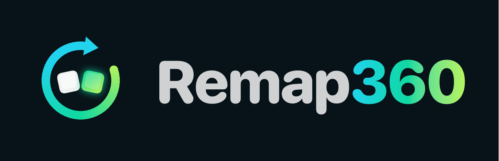
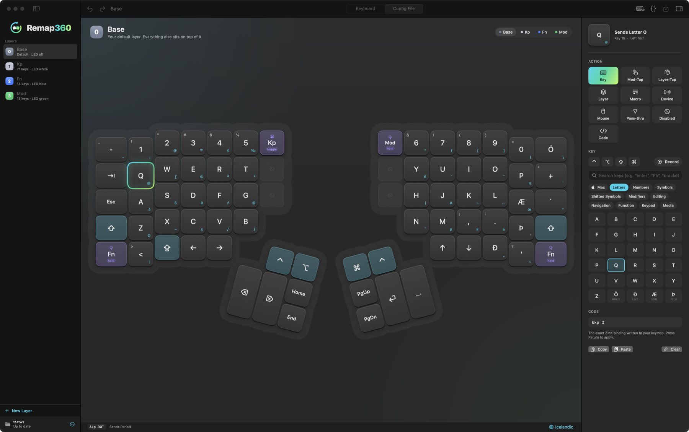
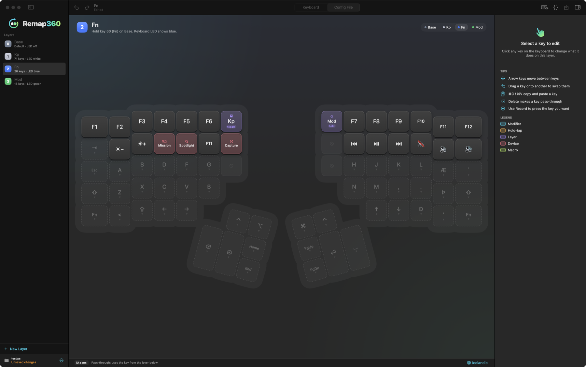

<p align="center"></p>

<p align="center"><b>A visual keymap editor for the Kinesis Advantage360 Pro, made for the Mac.</b><br>
Plug in, click a key, change it, and it's live on your keyboard instantly.</p>

<p align="center"></p>

## Features

- **Live editing over USB.** Changes are on the keyboard the moment you make them. Try them, then **Keep Changes** or **Revert**.
- **Your keyboard language on the keycaps.** Legends follow the Mac's keyboard layout (German, French, Nordic, Icelandic…), including the Shift and Option characters in the corners.
- **Mac shortcuts built in.** Mission Control, Spotlight, Show Desktop, Screenshot, Lock Screen, Emoji and more, plus volume, brightness and media keys.
- **One-click presets.** Add a MacBook-style top row (brightness, Mission Control, media, volume) to your Fn layer.
- **Test Pad.** Press keys and see exactly what your Mac receives, and which key on which layer sent it.
- **Backups.** Every time you keep changes, your layout is backed up automatically. Export and import layouts as files.
- **Firmware update notice.** Tells you when Kinesis publishes new firmware.
- Layers: add, rename, reorder, duplicate. Drag keys to swap them. Copy and paste keys. Full undo.

<p align="center"></p>

## Requirements

- macOS 15 or newer
- Kinesis Advantage360 **Pro** with firmware that supports live editing (Kinesis calls it "Clique" firmware). Older keyboards need [Kinesis' one-time firmware update](https://kinesis-ergo.com/360p-clique-upgrade/).
- A USB data cable for editing. Your saved layout works over Bluetooth as usual.

## Install

**[Download Remap360.dmg](https://github.com/daffy-dev/remap360/releases/latest/download/Remap360.dmg)**, open it and drag Remap360 into Applications. It's signed and notarized, and runs on Apple Silicon and Intel.

Or build it yourself:

```sh
git clone https://github.com/daffy-dev/remap360.git
cd remap360
scripts/bundle.sh --install   # builds Remap360.app and copies it to /Applications
```

Maintainers: `scripts/release.sh` builds a signed, notarized, universal DMG in `build/release/`.

Building needs Xcode 16 or newer.

## How to use it

1. Open Remap360 and connect the **left half** of the keyboard with USB.
2. The first time, unlock editing on the keyboard: **hold Mod and press Esc** (on the stock layout). Remap360 shows you which keys.
3. Click a key, choose what it should do, and type to try it.
4. Click **Keep Changes** to store it on the keyboard. It stays there through restarts and works over Bluetooth, without Remap360 running.

## FAQ

**How is this different from Kinesis Clique?**
Clique is Kinesis' official web editor and uses the same live-editing mechanism. Remap360 is a native Mac app that works without a Chrome-based browser, shows your own keyboard language on the keycaps, and adds Mac shortcut presets, the Test Pad and automatic backups. Changes made in one show up in the other.

**Does it change my keyboard's firmware?**
No. Live editing saves your layout as settings on the keyboard. Firmware tools exist but are experimental and hidden (Keyboard menu → Experimental Firmware Tools, needs Docker).

**Where are my backups?**
File → Show Layout Backups (`~/Library/Application Support/Remap360/Layout Backups`).

## Development

```sh
swift build
swift test
```

The core library (`Sources/Remap360Core`) holds the keymap parser, the ZMK Studio protocol and key code tables, and is covered by tests. The app (`Sources/Remap360`) is SwiftUI.

## Credits

- Built on [ZMK Firmware](https://zmk.dev) and its Studio RPC protocol.
- Layout data and the test fixture keymap come from Kinesis' MIT-licensed [Adv360-Pro-ZMK](https://github.com/KinesisCorporation/Adv360-Pro-ZMK) config.

Remap360 is not affiliated with or endorsed by Kinesis Corporation. Advantage360 is a trademark of Kinesis Corporation.

## License

[MIT](LICENSE)
